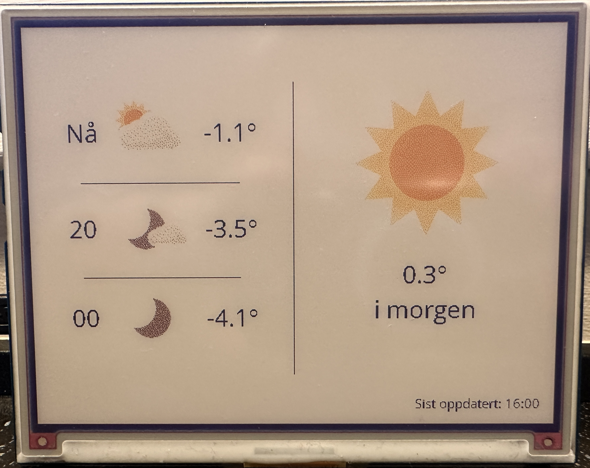
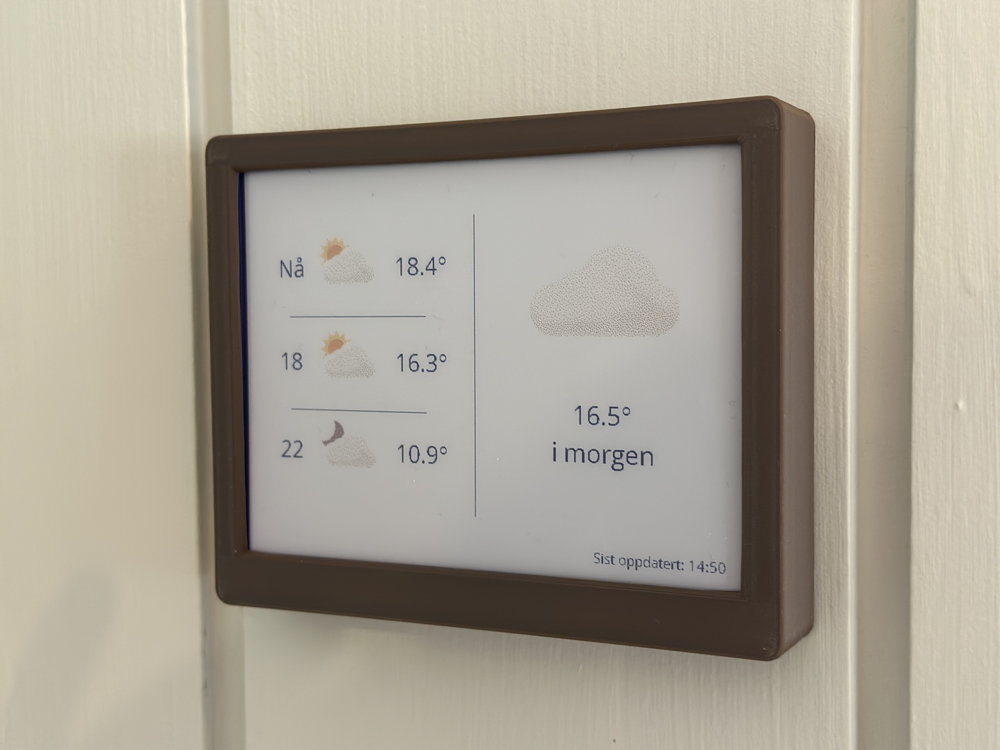

# MicroPython ePaper Weather Station

This project is a weather station built using MicroPython on a Raspberry Pi Pico W and a Waveshare 5.65-inch ePaper display. It fetches and displays weather data for a specified location.

## Screenshot
The device shows the weather data for Now, +4 hours, +8 hours, and tomorrow at 12:00. The small images are loaded from flash, the big image is fetched from my personal API. The reason the big images are in the API is because there is not enough storage on the flash. Feel free to use the api as is if you dont want to host your own.
<p align="left">
  
</p>

I have made a wallmount for the weatherstation, that can be 3D-printed.  
The wallmount can be downloaded here: [**fran on MakerWorld**](https://makerworld.com/en/models/1773343-wallmount-for-waveshare-pico-e-paper-5-65#profileId-1888240)  
<p align="left">
  
</p>

## Features
- **Weather Data**: Retrieves weather data from the MET Weather API.
- **ePaper Display**: Utilizes a Waveshare 5.65-inch ePaper display to display weather updates.
- **Wi-Fi Connectivity**: Connects to Wi-Fi to fetch the latest weather information.
- **Real-Time Updates**: Updates weather data and display in real-time.
- **Customizable Location**: Easily set your location to get accurate weather data.
- **Private Settings**: Wi-Fi password, email and coordinates are stored in `user_input.py`, which is never committed to git.
- **Summertime**: Norwegian summertime is calculated automatically.
- **Self-Recovery**: The Pico restarts itself after a fatal error, and the clock is synced every 24 hours.

## Components
- **MicroPython**: The project is written in MicroPython.
- **Raspberry Pi Pico 2 W**: The microcontroller used for this project.
- **Waveshare 5.65-inch ePaper Display**: The display used to show weather data.

## Getting Started
### Prerequisites
- Raspberry Pi Pico 2 W
- Waveshare 5.65-inch ePaper display
- MicroPython firmware installed on the Pico W
- Wi-Fi network

### Installation
1. **Clone the Repository**:  
   ```sh
   git clone https://github.com/frederik-andersen/micropython-ePaperWeatherStation.git
    ```
2. **Set up your own settings**:  
   All personal settings live in `user_input.py`. This file is in `.gitignore`, so your password and coordinates are never committed.
   - Copy `user_input_example.py` to `user_input.py`.
   - Fill in all values. The example values for coordinates are only an example (Drammen).
     ```python
     SSID = "your wifi name"
     WIFI_PASSWORD = "your wifi password"
     EMAIL = "you@example.com"   # Required by the MET API terms of service.
     LOCATION = "drammen"        # Lower case. Used as file name for the saved weather data.
     LATITUDE = 59.7396
     LONGITUDE = 10.2046
     ALTITUDE = 3                # Meters above sea level. The MET API uses it to adjust the temperature.
     ```
   - Never upload `user_input.py` to GitHub. Do not overwrite it when you update the code on the Pico.

3. **Location**:  
   - If you set `LATITUDE`, `LONGITUDE` and `ALTITUDE` in `user_input.py`, that is all you need.
   - Without coordinates, `LOCATION` must exist in the `locations` dictionary in `datafetcher.py` (`drammen` and `oslo` exist by default).
     ```python
     self.locations = {
         'drammen': {'latitude': 59.7396, 'longitude': 10.2046, 'altitude': 3},
         'oslo': {'latitude': 59.9108, 'longitude': 10.7577, 'altitude': 4}
     }
     ```

4. **Time zone**:  
   Norwegian time is built in: UTC+1 in winter and UTC+2 in summer (last Sunday in March to last Sunday in October, 01:00 UTC).
   For other countries, change `_get_time_difference` in `timemanager.py`.

5. **Optional: Translate to your language**:  
   The code is in English, but in ScreenManager the text is in Norwegian.
   Text to be translated:
  -  "Nå" -> "Now"
  -  "i morgen" -> "tomorrow"
  -  "Sist oppdatert" -> "Last update"
   
6. **Optional: Run your own api**:  
  - The code uses my API to store large images.
  - If you want other images than mine, you should run your own API. See the flask_api folder and run it on pythonanywhere.com.

7. **Upload the Code to Pico W**:
  - Use a tool like Thonny or rshell to upload the code to your Raspberry Pi Pico 2 W.
  - Upload `user_input.py` too. It must be in the top folder on the Pico, not in `lib`.
  - Do not upload the screenshots and flask_api directories.
  - If you update the code later, keep your own `user_input.py`. Make a backup of the Pico first.


### Usage
1. **Power On the Pico W**:
   - Connect your Raspberry Pi Pico W to a power source. `main.py` starts by itself.

2. **View Weather Data**:
   - The ePaper display shows the weather for your location: now, +4 hours, +8 hours and tomorrow at 12:00 UTC. The hour labels use local time.
   - The screen is redrawn every whole hour. The weather data is fetched again when the MET API says it has expired, plus a random delay of up to 60 minutes.
   - The screen is cleared once every 24 hours at 02:00 UTC to prevent ghosting.
   - The clock is synced with NTP at start and then every 24 hours.

### When something fails
The Pico is normally not connected to a computer, so errors are handled automatically:
- **No answer from the MET API**: The Pico waits 5 minutes and tries again. The screen keeps the last weather.
- **Wi-Fi is down**: The Pico retries every 5 minutes. The onboard LED flashes while it waits.
- **Icon API is down**: The screen is drawn without the big icon for tomorrow.
- **Any other fatal error** (for example NTP fails 5 times, or a missing icon): The screen is put to sleep, and the Pico waits 5 minutes and restarts itself with `machine.reset()`.
- **Missing `user_input.py`**: The program stops with the message `Missing user_input.py`. This error happens at import, so there is no automatic restart.
- Pressing Stop in Thonny stops the program without a restart.

If the screen shows old data and the LED is not flashing, connect the Pico to a computer and run `main.py` in Thonny to read the error message.

## TODO:
- Summertime follows Norwegian rules only.
- Not tested for long periods of Wi-Fi loss.


## Modifications and new libraries:
- The ePaper [driver](https://github.com/frederik-andersen/micropython-ePaper-5in65-border-color "New epaper driver") is changed so border color can be changed, and the buffer is allocated outside the class. This is to prevent memory leaks that happend with the original driver.

- EasyWriter is a library written by me to make it easier to add text and binary images to the screen.

- [Image to byte array](https://github.com/frederik-andersen/python-image_to_bytearray "Image to byte array") is used to convert ditered png files to binaries.
- [New epaper driver](https://github.com/frederik-andersen/micropython-ePaper-5in65-border-color "New epaper driver") is used to set the border color

## Contributing
Contributions are welcome! Please feel free to submit a Pull Request.

## License
This project is licensed under the MIT License - see the LICENSE file for details.

## Acknowledgements
- [**Peter Hinch**](https://github.com/peterhinch "PeterHinch"): For the writer class used for text rendering and font_to_py for fonts.
- [**Waveshare**](https://github.com/waveshareteam/e-Paper "Waveshare"): For the ePaper display and driver.
- [**Christopher Arndt**](https://github.com/SpotlightKid/mrequests "Christopher Arndt"): For mrequests. A better requests library.
- [**MET Weather API**](https://api.met.no/weatherapi/locationforecast/2.0/documentation "MET Weather API"): The weather api used for all data.
- [**MET Weather API icons**](https://github.com/metno/weathericons "MET Weather API icons"): For the weather images.
- [**Pythonanywhere**](https://www.pythonanywhere.com/ "Pythonanywhere"): For free python flask hosting.
